# Distributed Hilbert's Hotel ด้วยเทคนิค Consistent Hashing

โครงงานรายวิชา Object Oriented Data Structure ภาคการศึกษา 1/2569  
โปรแกรมภาษา Python สำหรับจัดสรรแขกเข้าพักในเครือโรงแรมอนันต์หลายอาคาร โดยคำนวณอาคารด้วย **Consistent Hashing** และคำนวณหมายเลขห้องด้วย **Cantor Pairing Function** เพื่อให้แขกเดิมไม่ต้องย้ายห้องเมื่อมีแขกใหม่เข้ามา และย้ายอาคารน้อยที่สุดเมื่อเพิ่มหรือถอนอาคาร

## 1. ที่มาและแนวคิดของระบบ

ในปัญหา Hilbert's Hotel ดั้งเดิม โรงแรมมีอาคารเดียวที่มีห้องพักไม่จำกัด แต่ทุกครั้งที่มีแขกใหม่เข้ามา แขกเดิมทั้ง $K$ คนต้องขยับห้องทีละคน คิดเป็นต้นทุน $\Theta(K)$ ต่อการรับแขกหนึ่งครั้ง

เมื่อขยายเป็นเครือโรงแรมที่มี $N$ อาคาร (แต่ละอาคารมีห้องพักไม่จำกัด) หากเลือกอาคารด้วยวิธีตรงไปตรงมาอย่าง `hash(guest) mod N` การเพิ่มอาคารเพียงหลังเดียวจะทำให้ตัวหารเปลี่ยนจาก $N$ เป็น $N+1$ ส่งผลให้เศษจากการหารเปลี่ยนเกือบทุกคน แขกประมาณ $\frac{N}{N+1}$ ของระบบจึงต้องย้ายอาคารพร้อมกัน

โครงงานนี้แก้ปัญหาทั้งสองส่วนแยกกัน:
1. **การเลือกอาคารด้วย Consistent Hashing และ Virtual Nodes**: แปลงทั้งรหัสแขกและจุดตัวแทนของอาคาร (virtual node จำนวน $V$ จุดต่ออาคาร รวม $M = N \times V$ จุด) ด้วย SHA-256 ให้เป็นตำแหน่งบนวงแหวนขนาด $0$ ถึง $2^{64}-1$ แขกแต่ละคนจะเข้าพักที่อาคารของจุดแรกที่มีตำแหน่งมากกว่าหรือเท่ากับตำแหน่งของแขกเมื่อเดินตามเข็มนาฬิกา (หากเกินจุดสุดท้ายจะวนกลับไปจุดแรกของวงแหวน) เมื่อเพิ่มหรือลดอาคารหนึ่งหลัง จะมีเพียงช่วงสั้นๆ บนวงแหวนที่เปลี่ยนเจ้าของ แขกที่ต้องย้ายอาคารจึงมีค่าคาดหวังเพียง $\frac{K}{N+1}$ (เมื่อเพิ่มอาคาร) หรือ $\frac{K}{N}$ (เมื่อถอนอาคาร)
2. **การกำหนดหมายเลขห้องด้วย Cantor Pairing Function**: คำนวณเลขห้อง `room_no` จากรหัสแขก `(c, s)` โดยตรงด้วยสูตรคณิตศาสตร์แบบหนึ่งต่อหนึ่ง (bijection) ไม่พึ่งตัวนับเลขห้องล่าสุด ทำให้เมื่อรับแขกใหม่ แขกเดิมไม่ขยับห้อง และเมื่อแขกต้องย้ายอาคาร เลขห้อง `room_no` ยังคงเดิม เปลี่ยนเฉพาะรหัสอาคาร `node_id`

## 2. ความต้องการของระบบและโครงสร้างโปรเจกต์

* **Python**: เวอร์ชัน 3.10 ขึ้นไป (พัฒนาและทดสอบบน `Python 3.13.5`)
* **โมดูลมาตรฐาน (Standard Library)**: `bisect`, `hashlib`, `dataclasses`, `csv`, `time`, `tracemalloc`, `statistics`, `unittest` (ส่วนหลักและเมนู CLI ไม่พึ่งแพ็กเกจภายนอก)
* **แพ็กเกจเสริมสำหรับวาดกราฟ**: `matplotlib>=3.8` (ใช้เฉพาะใน `plots.py` เมื่อสั่งวาดกราฟ PNG)

```text
OOD_Camel_Hotel/
├── hash_ring.py         # Part 1: คลาส HashRing (SHA-256 64-bit + bisect) และ ModuloNodeSelector
├── guest_room.py        # Part 2: คลาส Guest, สูตร cantor_room_no และคลาส GuestManager (ดัชนี 2 ทาง)
├── building_manager.py  # Part 3: คลาส BuildingManager, MoveRecord, BuildingChangeResult
├── common.py            # Part 4: ค่าคงที่ พารามิเตอร์การทดลอง (K, N, V, salt) และฟังก์ชันสถิติ/วัดหน่วยความจำ
├── experiments.py       # Part 4: สคริปต์รันการทดลอง A, B, C และบันทึกไฟล์ CSV
├── plots.py             # Part 4: สคริปต์สร้างกราฟ PNG ทั้ง 3 ภาพจากผลการทดลอง
├── menu.py              # Part 5: โปรแกรมเมนูข้อความ (Interactive CLI) ครบทุกฟังก์ชัน
├── test_all.py          # Part 5: ชุดทดสอบอัตโนมัติ (unittest 34 ข้อ) ครอบคลุมกติกาและกรณีขอบทั้งหมด
├── requirements.txt     # รายการแพ็กเกจเสริมสำหรับวาดกราฟ (matplotlib>=3.8)
├── report/              # สคริปต์วัดค่าเพิ่มที่ใช้ประกอบรายงาน (extra_measurements.py)
├── results/             # ไฟล์ CSV ข้อมูลแขกตัวอย่าง รายการย้าย ผลการทดลอง A, B, C และผลดิบของชุดทดสอบ
├── figures/             # ไฟล์กราฟ PNG ทั้ง 3 ภาพจากการทดลอง A, B, C
└── README.md            # เอกสารอธิบายระบบ วิธีใช้งาน การวิเคราะห์ Big-O และผลการทดลอง
```

## 3. วิธีเรียกใช้งานโปรแกรมและรันชุดทดสอบ

### 3.1 การรันชุดทดสอบอัตโนมัติ (Unit Tests)
รันสคริปต์ทดสอบกติกาหลัก ตัวอย่างวงแหวนเล็ก (หัวข้อ 9.1) และกรณีขอบทั้งหมด (หัวข้อ 4.5 และ 9.2):
```bash
python -m unittest test_all.py -v
```

### 3.2 การรันโปรแกรมเมนูโต้ตอบ (`menu.py`)
```bash
python menu.py
```
คำสั่งในเมนูทั้ง 13 รายการเชื่อมกับข้อกำหนดในหัวข้อ 5 ของเอกสารโครงงานดังนี้:
* `1. Run System`: เริ่มระบบโดยกำหนดจำนวนอาคารเริ่มต้น $N$, จำนวนจุดเสมือนต่ออาคาร $V$, ค่า `salt`, จำนวนช่องทาง และจำนวนแขกเริ่มต้นต่อช่องทาง (ลำดับ $s$ เริ่มที่ 1)
* `2. Add Guest (per person)`: เพิ่มแขกรายบุคคลด้วยรหัส `(c, s)`
* `3. Add Group (c, defult s, number of guest)`: เพิ่มแขกเป็นกลุ่มด้วย `(c, s_start, count)` หากมีรหัสซ้ำแม้เพียงรายการเดียวจะปฏิเสธทั้งกลุ่ม
* `4. Remove Guest`: นำแขกรายบุคคลออกด้วยรหัส `(c, s)`
* `5. Add Building` / `6. Remove Building`: เพิ่มหรือลบอาคารตามรหัสที่ระบุ พร้อมรายงานจำนวนแขกที่ย้าย อัตราย้าย เทียบค่าคาดหวัง เวลาแยก 3 ขั้นตอน และรายการแขกที่ย้าย
* `7. Find Guest by ID`: ค้นหาจากรหัสแขก `(c, s)` เพื่อดู `(node_id, room_no)` โดยคำนวณอาคารจากวงแหวนปัจจุบันเสมอ
* `8. Find Room by ID (building , room)`: ค้นหาย้อนกลับจาก `(node_id, room_no)` เพื่อดูรหัสแขก `(c, s)`
* `9. Room Lists`: แสดงจำนวนห้องที่มีผู้พักทั้งหมดและรายการห้องเรียงตาม `node_id` จากน้อยไปมาก ตามด้วย `room_no` จากน้อยไปมาก
* `10. Load Reports`: รายงานจำนวนแขกทุกอาคาร (รวมอาคารที่มี 0 คน) พร้อมค่า `max`, `min`, `mean`, `sd`, และ `cv`
* `11. Export CSV (Guests & Last Moves)`: ส่งออกไฟล์ CSV แบบ UTF-8 (`results/menu_export_guests.csv` และ `results/menu_export_last_moves.csv`)
* `12. Compare Consistent vs Modulo Hashing`: เปรียบเทียบจำนวนและอัตราการย้ายระหว่าง Consistent Hashing กับ `hash mod N` บนชุดแขกเดียวกันทั้งกรณีเพิ่มและลบอาคาร
* `13. Measure Performance (Time & Memory)`: วัดเวลาฟังก์ชันหลักด้วย `time.perf_counter()` (ค้นหาเป็นชุด 1,000 ครั้งหารต่อครั้ง) และวัดหน่วยความจำด้วย `tracemalloc` แยกรอบจากเวลา พร้อมแสดงพารามิเตอร์การทดลอง

### 3.3 การรันชุดการทดลอง A, B, C และสร้างกราฟ (`experiments.py`)
หากต้องการรันการทดลองใหม่และวาดกราฟทั้ง 3 ภาพ:
```bash
pip install -r requirements.txt
python experiments.py
```
ค่าของ `hash mod N` ที่ไฟล์ใน `results/` ไม่มี (เวลาค้นหา, CV, หน่วยความจำ) วัดเพิ่มด้วยสคริปต์แยก ซึ่งไม่เขียนทับไฟล์ใด:
```bash
python report/extra_measurements.py
```

## 4. การออกแบบเชิงวัตถุ (OOP) และโครงสร้างข้อมูล

### 4.1 แผนภาพคลาส (Class Diagram)

```mermaid
classDiagram
    class HashRing {
        +int v_nodes
        +int|str|None salt
        +list~tuple~ ring
        +set~str~ nodes
        +hash_guest(c: int, s: int) int
        +hash_vnode(node_id: str, j: int) int
        +add_node(node_id: str, custom_positions: list) tuple~bool, str~
        +remove_node(node_id: str) tuple~bool, str~
        +get_node_by_position(guest_pos: int) str
        +get_node(c: int, s: int) str
    }

    class ModuloNodeSelector {
        +int|str|None salt
        +list~str~ nodes
        +set~str~ _node_set
        +hash_guest(c: int, s: int) int
        +add_node(node_id: str) tuple~bool, str~
        +remove_node(node_id: str) tuple~bool, str~
        +get_node(c: int, s: int) str
    }

    class Guest {
        +int c
        +int s
        +int room_no
        +str node_id
    }

    class GuestManager {
        +HashRing ring
        +dict guests
        +dict room_index
        +add_guest(c: int, s: int) tuple~bool, str~
        +add_guests(ids: list) tuple~bool, str~
        +add_guests_range(c: int, s_start: int, count: int) tuple~bool, str~
        +populate_initial(channels: int, per_channel: int) tuple~bool, str~
        +remove_guest(c: int, s: int) tuple~bool, str~
        +find_by_guest(c: int, s: int) tuple~str, int~
        +find_by_room(node_id: str, room_no: int) tuple~int, int~
        +list_rooms() list~tuple~
        +load_per_node() dict~str, int~
        +find_misplaced() list~tuple~
        +move_guest(c: int, s: int, new_node: str) bool
        +verify_consistency() bool
    }

    class MoveRecord {
        +int c
        +int s
        +str old_node
        +str new_node
        +int room_no
    }

    class BuildingChangeResult {
        +bool ok
        +str message
        +str action
        +str building_id
        +int n_before
        +int total_guests
        +int moved_count
        +float moved_rate
        +float expected_moved
        +list~MoveRecord~ moves
        +list~str~ rule_violations
        +bool consistent
    }

    class BuildingManager {
        +HashRing ring
        +GuestManager guests
        +bool check_rules
        +add_building(building_id: str) BuildingChangeResult
        +remove_building(building_id: str) BuildingChangeResult
        +list_buildings() list~str~
    }

    GuestManager --> HashRing : คำนวณอาคารด้วย get_node()
    GuestManager *-- Guest : จัดเก็บใน dict
    BuildingManager --> HashRing : ปรับวงแหวน add/remove_node()
    BuildingManager --> GuestManager : หาผู้ย้ายและอัปเดตดัชนี
    BuildingManager ..> BuildingChangeResult : คืนผลลัพธ์
    BuildingChangeResult *-- MoveRecord : รายการย้าย
```



### 4.2 เหตุผลในการเลือกโครงสร้างข้อมูล
1. **วงแหวน (`HashRing.ring`) ใช้ `list[tuple[int, str, int]]` ที่เรียงลำดับตาม `(position, node_id, j)` คู่กับ `bisect`**:
   * งานหลักที่เกิดขึ้นบ่อยที่สุดคือการค้นหาอาคารจากตำแหน่งแฮชของแขก การเก็บจุดเสมือน $M = N \times V$ จุดใน `list` ที่เรียงลำดับแล้วค้นหาด้วย `bisect.bisect_left(self.ring, (guest_pos, "", -1))` ใช้เวลาเพียง $O(\log M)$ และใช้หน่วยความจำต่อเนื่องขนาดกะทัดรัดกว่าโครงสร้างต้นไม้แบบมีตัวชี้
   * การเรียงทูเพิล `(position, node_id, j)` ทำให้เมื่อเกิดแฮชชนกันบนวงแหวน ระบบจะเลือกจุดที่มีรหัสอาคารน้อยกว่าและลำดับจุดเสมือน $j$ น้อยกว่าโดยอัตโนมัติตามกติกาหัวข้อ 4.3 ข้อ 4
2. **ข้อมูลแขก (`GuestManager.guests`) ใช้ `dict[tuple[int, int], Guest]`**:
   * ใช้คู่รหัส `(c, s)` เป็นคีย์ของ hash table ทำให้ตรวจสอบรหัสซ้ำ ค้นหาแขก และลบแขกได้ในเวลาเฉลี่ย $O(1)$
3. **ดัชนีค้นหาย้อนกลับ (`GuestManager.room_index`) ใช้ `dict[tuple[str, int], tuple[int, int]]`**:
   * จับคู่ `(node_id, room_no) -> (c, s)` เพื่อให้การค้นหาด้วยที่อยู่ห้อง (`find_by_room`) ทำได้ในเวลาเฉลี่ย $O(1)$ โดยไม่ต้องวนค้นแขกทั้ง $K$ คน

### 4.3 การรักษาความสอดคล้องของข้อมูลและดัชนีเมื่อแขกย้ายอาคาร
เมื่อเพิ่มหรือลบอาคารผ่าน `BuildingManager._change()`:
1. ปรับวงแหวนใน `HashRing` ก่อน (ถ้าคำสั่งถูกปฏิเสธ เช่น รหัสซ้ำหรือลบอาคารสุดท้าย จะหยุดทันทีโดยไม่แตะข้อมูลแขก)
2. เรียก `guests.find_misplaced()` เพื่อคำนวณอาคารใหม่ของแขกจากวงแหวนปัจจุบัน (`self.ring.get_node(c, s)`) เทียบกับ `g.node_id` เดิม
3. สำหรับแขกที่ต้องย้ายแต่ละคน จะเรียก `guests.move_guest(c, s, new_node)` ซึ่งทำงาน 3 ขั้นตอนควบคู่กัน:
   * ลบคีย์เดิม `del self.room_index[(g.node_id, g.room_no)]`
   * อัปเดต `g.node_id = new_node` (โดย `g.room_no` คงเดิม)
   * เพิ่มคีย์ใหม่ `self.room_index[(new_node, g.room_no)] = (c, s)`
4. เรียก `guests.verify_consistency()` เพื่อยืนยันว่าจำนวนรายการในดัชนีทั้งสองเท่ากัน ดัชนีห้องชี้กลับมารหัสแขกตรงกันทุกคู่ และ `ring.get_node(c, s)` ตรงกับ `g.node_id` ของแขกทุกคน

## 5. กติกาการคำนวณหลักและกรณีขอบ

### 5.1 หมายเลขห้องด้วย Cantor Pairing Function (หัวข้อ 4.2)
กำหนดให้ $a = c - 1$ และ $b = s - 1$ (แปลงจำนวนเต็มบวก $c, s \ge 1$ ให้เป็นจำนวนเต็มไม่ติดลบ $a, b \ge 0$):
$$\text{room\_no} = \frac{(a + b)(a + b + 1)}{2} + b + 1$$
ในโค้ดใช้การหารจำนวนเต็ม `((a + b) * (a + b + 1)) // 2 + b + 1` ตลอดการคำนวณ

**เหตุผลที่เลขห้องไม่ซ้ำกัน**: กำหนดให้ $w = a + b$ ค่าก้อนแรก $\frac{w(w+1)}{2} = 1 + 2 + \dots + w$ คือจำนวนคู่ลำดับทั้งหมดที่อยู่บนเส้นทแยงมุมก่อนหน้า ($a' + b' < w$) และเนื่องจาก $0 \le b \le w$ ค่า $\frac{w(w+1)}{2} + b$ จึงระบุตำแหน่งบนเส้นทแยงมุมที่ $w$ ได้เพียงค่าเดียวโดยไม่ทับกับเส้นทแยงมุมถัดไปซึ่งเริ่มที่ $\frac{(w+1)(w+2)}{2} = \frac{w(w+1)}{2} + w + 1$ เมื่อบวก $1$ จึงได้จำนวนเต็มบวกที่ต่างกันสำหรับทุกคู่ $(c, s)$ ที่ต่างกัน

| รหัสแขก `(c, s)` | `(1, 1)` | `(2, 1)` | `(1, 2)` | `(3, 1)` | `(2, 2)` |
| :--- | :---: | :---: | :---: | :---: | :---: |
| `a = c - 1, b = s - 1` | `(0, 0)` | `(1, 0)` | `(0, 1)` | `(2, 0)` | `(1, 1)` |
| `room_no` | `1` | `2` | `3` | `4` | `5` |

### 5.2 การแฮชลงวงแหวน 64 บิต และการแยกข้อความ (หัวข้อ 4.3)
* ใช้ SHA-256 เข้ารหัสข้อความ UTF-8 แล้วตัด 8 ไบต์แรกแปลงเป็นจำนวนเต็ม 64 บิตแบบ big-endian (`int.from_bytes(digest[:8], byteorder="big", signed=False)`) ได้ค่าในช่วง $0$ ถึง $2^{64}-1$ ที่คงที่ข้ามการเปิดโปรแกรม (ไม่ใช้ `hash()` ของ Python)
* แยกข้อความระหว่างแขกกับจุดเสมือนของอาคาร:
  * แขก: `guest:{c}:{s}` (หรือ `salt:{salt}:guest:{c}:{s}` เมื่อระบุ `salt`)
  * จุดเสมือนของอาคาร: `node:{node_id}:{j}` สำหรับ $j = 0, 1, \dots, V-1$ (หรือ `salt:{salt}:node:{node_id}:{j}`)

### 5.3 การจัดการกรณีขอบทั้งหมด (หัวข้อ 4.5)
| กรณีขอบ | การทำงานของโปรแกรม |
| :--- | :--- |
| เพิ่มรหัสอาคารที่มีอยู่แล้ว | `HashRing.add_node` ปฏิเสธ คืน `(False, "ปฏิเสธคำสั่ง: อาคาร '...' มีอยู่ในระบบแล้ว")` วงแหวนและข้อมูลแขกไม่เปลี่ยน |
| ลบรหัสอาคารที่ไม่มีอยู่ | `HashRing.remove_node` ปฏิเสธ คืน `(False, "ปฏิเสธคำสั่ง: ไม่พบอาคาร '...' ในระบบ")` |
| ลบอาคารสุดท้าย ($N = 1$) | `HashRing.remove_node` ปฏิเสธ คืน `(False, "ปฏิเสธคำสั่ง: ไม่สามารถลบอาคารสุดท้ายได้ ...")` รักษาเงื่อนไข $N \ge 1$ เสมอ |
| เพิ่มรหัสแขกซ้ำ (เดี่ยวและกลุ่ม) | รายบุคคลปฏิเสธทันที; แบบกลุ่ม (`add_guests` / `add_guests_range`) ตรวจสอบทั้งกลุ่มก่อน หากซ้ำแม้ 1 รายการจะปฏิเสธทั้งกลุ่ม (All-or-Nothing) |
| นำแขกที่ไม่มีอยู่ออก | `GuestManager.remove_guest` ปฏิเสธ คืน `(False, "Rejected: guest (c,s) not found")` สถิติไม่เพี้ยน |
| ค้นหาแล้วไม่พบ | `find_by_guest` และ `find_by_room` คืน `None` เมนูแสดงข้อความว่าไม่พบโดยไม่หยุดทำงาน |
| ยังไม่มีแขกในระบบ ($K = 0$) | การเพิ่ม/ลบอาคารรายงานจำนวนย้ายเป็น `0` และ `moved_rate = None` พร้อมระบุสาเหตุ ส่วน `load_statistics` คืน `cv = None` ไม่หารด้วยศูนย์ |

## 6. การวิเคราะห์ความซับซ้อน Big-O (หัวข้อ 8)

กำหนดให้ $N$ คือจำนวนอาคาร, $V$ คือจำนวนจุดเสมือนต่ออาคาร, $M = N \times V$ คือจำนวนจุดทั้งหมดบนวงแหวน, และ $K$ คือจำนวนแขกในระบบ (สมมติให้ขนาดของรหัสแขก รหัสอาคาร และการเปรียบเทียบ/แฮชข้อความสั้นๆ มีขนาดคงที่ $O(1)$)

### 6.1 ตารางวิเคราะห์ Big-O ของทุกฟังก์ชันหลักในโค้ดจริง
| ขั้นตอน / ฟังก์ชัน | Average / Expected Time | Worst-Case Time | คำอธิบายจากโค้ดจริง |
| :--- | :---: | :---: | :--- |
| **1ก) สร้างวงแหวนเริ่มต้น** (`_build_initial_ring`) | $O(M \log M)$ | $O(M \log M)$ | สร้างจุดเสมือน $M = NV$ จุดใส่ `list` แล้วเรียก `self.ring.sort()` ด้วย Timsort |
| **1ข) จัดแขกเริ่มต้น $K$ คน** (`populate_initial`) | $O(K \log M)$ | $O(K(K + \log M))$ | แขกแต่ละคนค้นวงแหวนด้วย `bisect_left` ใช้ $O(\log M)$ และบันทึกใน `dict` 2 ชุด (เฉลี่ย $O(1)$ ต่อคน, กรณีเลวร้ายสุดของ hash table ชนกันคือ $O(K)$ ต่อคน) |
| **2ก) เพิ่มแขก 1 คน** (`add_guest`) | $O(\log M)$ | $O(K + \log M)$ | เช็คซ้ำใน `dict` เฉลี่ย $O(1)$ + ค้นวงแหวนด้วย `bisect_left` $O(\log M)$ + คำนวณ Cantor $O(1)$ + บันทึก `dict` 2 ชุด |
| **2ข) เพิ่มแขกเป็นกลุ่ม $B$ คน** (`add_guests` / `add_guests_range`) | $O(B \log M)$ | $O(B(K + B + \log M))$ | ตรวจความถูกต้องและเช็คซ้ำใน `set`/`dict` ทั้ง $B$ คนก่อน ($O(B)$ เฉลี่ย) แล้วเพิ่มทีละคนด้วย `_insert` $B$ ครั้ง |
| **2ค) นำแขกออก 1 คน** (`remove_guest`) | $O(1)$ | $O(K)$ | ลบคีย์ออกจาก `self.guests` และ `self.room_index` อย่างละ 1 รายการ |
| **3ก) ค้นหาผ่านรหัสแขก** (`find_by_guest`) | $O(\log M)$ | $O(K + \log M)$ | ค้น `self.guests.get((c, s))` เฉลี่ย $O(1)$ และคำนวณอาคารสดจากวงแหวน `self.ring.get_node(c, s)` ด้วย `bisect_left` $O(\log M)$ |
| **3ข) ค้นหาผ่านที่อยู่ห้อง** (`find_by_room`) | $O(1)$ | $O(K)$ | ค้นจาก `self.room_index.get((node_id, room_no))` โดยตรง |
| **3ค) คำนวณอาคารจากวงแหวนสด** (`get_node`) | $O(\log M)$ | $O(\log M)$ | แฮช SHA-256 $O(1)$ + ค้นด้วย `bisect_left` บนลิสต์ขนาด $M$ ใช้ $O(\log M)$ |
| **4) เรียงรายการห้อง** (`list_rooms`) | $O(K \log K)$ | $O(K \log K)$ | สร้างรายการขนาด $K$ และเรียงด้วย `sorted()` ตาม `(node_id, room_no, c, s)` |
| **5) เพิ่มอาคาร 1 หลัง** (`add_building`)<br>- (ก) ปรับวงแหวน (`add_node`)<br>- (ข) หาแขกที่กระทบ (`find_misplaced` แบบ ก)<br>- (ค) ปรับข้อมูลและดัชนี (`move_guest` + `verify_consistency`) | <br>$O(V \cdot M)$<br>$O(K \log M)$<br>$O(K \log M)$ | <br>$O(V \cdot M)$<br>$O(K \log M)$<br>$O(K(K + \log M))$ | <br>- แทรก $V$ จุดด้วย `bisect.insort` ลงใน `list` (หาตำแหน่ง $O(\log M)$ แต่เลื่อนสมาชิกใน `list` ใช้ $O(M)$ ต่อจุด)<br>- วนตรวจแขกครบ $K$ คนและค้นวงแหวนคนละ $O(\log M)$<br>- ย้ายแขกคาดหวัง $\Delta K \approx \frac{K}{N+1}$ คนใน `dict` 2 ชุด + เรียก `verify_consistency()` ที่ตรวจครบ $K$ คน ($O(K \log M)$) |
| **5) ลบอาคาร 1 หลัง** (`remove_building`)<br>- (ก) ปรับวงแหวน (`remove_node`)<br>- (ข) หาแขกที่กระทบ (`find_misplaced` แบบ ก)<br>- (ค) ปรับข้อมูลและดัชนี (`move_guest` + `verify_consistency`) | <br>$O(M)$<br>$O(K \log M)$<br>$O(K \log M)$ | <br>$O(M)$<br>$O(K \log M)$<br>$O(K(K + \log M))$ | <br>- สร้าง `list` ใหม่กรองจุดของอาคารที่ลบออกในรอบเดียว $O(M)$<br>- วนตรวจแขกครบ $K$ คนและค้นวงแหวนคนละ $O(\log M)$<br>- ย้ายแขกคาดหวัง $\Delta K \approx \frac{K}{N}$ คนใน `dict` 2 ชุด + `verify_consistency()` $O(K \log M)$ |

### 6.2 การวิเคราะห์พื้นที่หน่วยความจำ (Space Complexity)
* **พื้นที่วงแหวน (`HashRing`)**: เก็บชุดรหัสอาคาร $O(N)$ และรายการจุดเสมือน $M = NV$ จุด ใช้พื้นที่ $O(NV)$
* **พื้นที่ข้อมูลแขกและดัชนีค้นหา (`GuestManager`)**: เก็บ `self.guests` จำนวน $K$ รายการ และดัชนี `self.room_index` จำนวน $K$ รายการ ใช้พื้นที่ $O(K)$
* **พื้นที่ข้อมูลหลักรวม**: $O(NV + K)$
* **พื้นที่ชั่วคราว (Auxiliary Space)**:
  * ตอนเรียงรายการห้อง (`list_rooms`): สร้างลิสต์ผลลัพธ์ขนาด $K$ ใช้พื้นที่ชั่วคราว $O(K)$
  * ตอนเพิ่ม/ลบอาคาร: เก็บรายการ `misplaced` และ `moves` ตามจำนวนผู้ย้ายจริง $\Delta K \le K$ ใช้พื้นที่ชั่วคราวคาดหวัง $O(K/N)$ และกรณีเลวร้ายสุด $O(K)$

### 6.3 ตารางเปรียบเทียบ `hash mod N` กับ `Consistent Hashing` (หัวข้อ 8.2)
| ประเด็นเปรียบเทียบ | `hash mod N` (`ModuloNodeSelector`) | `Consistent Hashing` (`HashRing`) |
| :--- | :--- | :--- |
| **การคำนวณอาคาร** | วิเคราะห์: $O(1)$ (แฮชแล้วหารเอาเศษ)<br>วัดจริง: ~0.9–1.1 $\mu\text{s}$ ต่อครั้ง | วิเคราะห์: $O(\log(NV))$ (แฮชแล้วค้นด้วย `bisect_left`)<br>วัดจริง ($N=10, V=32$): ~1.26–1.51 $\mu\text{s}$ ต่อครั้ง |
| **เวลาเพิ่ม/ลบอาคาร** | วิเคราะห์: ปรับรายการอาคาร $O(N)$, ตรวจและย้ายแขก $O(K)$<br>วัดจริง ($K=10{,}000, N=10$): ~18.7 ms | วิเคราะห์: ปรับวงแหวน $O(V^2 N)$ หรือ $O(NV)$, ตรวจแขกแบบ ก $O(K \log(NV))$<br>วัดจริง ($K=10{,}000, N=10, V=32$): ~20.2 ms |
| **อัตราการย้ายแขกเมื่อเพิ่ม 1 อาคาร** | วิเคราะห์ (คาดหวัง): $\frac{N}{N+1}$ (เช่น $N=10 \to 90.91\%$, $N=20 \to 95.24\%$)<br>วัดจริง (มัธยฐาน 3 รอบ): $83.37\%$ ($N=5$), $91.00\%$ ($N=10$), $95.20\%$ ($N=20$) | วิเคราะห์ (คาดหวัง): $\frac{1}{N+1}$ (เช่น $N=10 \to 9.09\%$, $N=20 \to 4.76\%$)<br>วัดจริง (มัธยฐาน 3 รอบ): $18.59\%$ ($N=5$), $10.68\%$ ($N=10$), $3.74\%$ ($N=20$) |
| **อัตราการย้ายแขกเมื่อลบ 1 อาคาร** | วิเคราะห์ (คาดหวัง): ขึ้นกับตำแหน่งอาคารที่ลบ (ลบตัวแรก `NODE01` ทำให้ดัชนีเลื่อนทุกตัว ย้ายราว $\frac{N-1}{N}$)<br>วัดจริง (ลบ `NODE01`): $79.74\%$ ($N=5$), $89.76\%$ ($N=10$), $94.76\%$ ($N=20$) | วิเคราะห์ (คาดหวัง): $\frac{1}{N}$ (ย้ายเฉพาะแขกของอาคารที่ถูกลบ)<br>วัดจริง (ลบ `NODE01`): $22.00\%$ ($N=5$), $9.56\%$ ($N=10$), $5.08\%$ ($N=20$) |
| **พื้นที่จัดเส้นทาง (Routing Space)** | วิเคราะห์: $O(N)$ เก็บ `list` และ `set` ของรหัสอาคาร ($O(1)$ เฉพาะสูตรหารเอาเศษ) | วิเคราะห์: $O(NV)$ เก็บจุดเสมือน $M = NV$ จุดบนวงแหวน<br>วัดจริง ($N=10, V=32$): ~35.5 KiB |
| **พื้นที่ข้อมูลรวม (Total Space)** | วิเคราะห์: $O(N + K)$ (รายการอาคาร $N$ หลัง + ข้อมูลแขกและดัชนี $K$ คน) | วิเคราะห์: $O(NV + K)$<br>วัดจริง ($K=10{,}000, N=10, V=32$): Current 3.83 MiB / Peak 5.37 MiB |
| **ความสมดุลของโหลด (Load CV)** | กระจายสม่ำเสมอตาม SHA-256 ($\text{CV} \approx 0.01$) แต่แลกมาด้วยการย้ายแขกเกือบทั้งระบบเมื่อเปลี่ยนจำนวนอาคาร | ปรับความสมดุลได้ด้วยค่า $V$: วัดจริงที่ $N=10, K=10{,}000$ ค่ามัธยฐาน $\text{CV}$ ลดจาก $0.6015$ ($V=1$) $\to 0.2627$ ($V=8$) $\to 0.1438$ ($V=32$) |

## 7. สรุปผลการทดลอง A, B, C และการอภิปรายผล (หัวข้อ 7)

การทดลองทั้งหมดสร้างแขกจาก 10 ช่องทางกระจายจำนวนเท่ากัน รันซ้ำการทดลองละ 3 รอบด้วย `salt = 0, 1, 2` รายงานค่ามัธยฐานพร้อมช่วงต่ำสุด–สูงสุด และวัดหน่วยความจำด้วย `tracemalloc` ในรอบที่แยกจากรอบจับเวลา

* **การทดลอง A (ขนาดข้อมูล $K = 1{,}000; 10{,}000; 100{,}000$ ที่ $N=10, V=32$)**:
  * เวลาจัดแขกเริ่มต้น (`t_assign_guests_s`) โตเชิงเส้นตาม $K$: `2.46 ms` ($1\text{k}$) $\to$ `25.79 ms` ($10\text{k}$) $\to$ `322.82 ms` ($100\text{k}$) สอดคล้องกับ $O(K \log M)$ เมื่อ $M = 320$ คงที่
  * เวลาค้นหาต่อครั้ง (`find_by_guest` ~1.40–2.13 $\mu\text{s}$, `find_by_room` ~0.07–0.40 $\mu\text{s}$) แทบไม่เพิ่มขึ้นตาม $K$ เพราะพึ่งการค้นใน `dict` $O(1)$ และ `bisect_left` บนวงแหวนขนาด $M=320$
  * หน่วยความจำที่ Python ติดตาม (`tracemalloc`) โตเชิงเส้นตาม $K$: Current `0.50 MiB` ($1\text{k}$) $\to$ `3.83 MiB` ($10\text{k}$) $\to$ `42.10 MiB` ($100\text{k}$)
* **การทดลอง B (จำนวนอาคาร $N = 5; 10; 20$ ที่ $K=10{,}000, V=32$)**:
  * เมื่อเพิ่มหรือลบ 1 อาคาร อัตราการย้ายของ Consistent Hashing ลดลงตามสัดส่วน $\approx \frac{1}{N+1}$ และ $\frac{1}{N}$ (เช่น ที่ $N=20$ ย้ายเพียง $3.74\%$ เมื่อเพิ่มอาคาร และ $5.08\%$ เมื่อลบอาคาร) ในขณะที่ `hash mod N` ต้องย้ายแขกถึง $95.20\%$ และ $94.76\%$
  * **ทำไมค่าที่วัดได้จริงจึงต่างจากค่าคาดหวัง $\frac{K}{N+1}$ และ $\frac{K}{N}$ เล็กน้อย**: ค่า $\frac{K}{N+1}$ และ $\frac{K}{N}$ เป็นค่าคาดหวังทางสถิติเมื่อจุดเสมือนบนวงแหวนแบ่งระยะห่างเท่ากันทุกช่วง ในการทำงานจริง ตำแหน่งของจุดเสมือน $V=32$ จุดต่ออาคารเกิดจากค่าแฮช SHA-256 ของรหัสอาคารและ `salt` ในแต่ละรอบ ทำให้ความยาวช่วงบนวงแหวนที่อาคารใหม่เข้าไปแทรก (หรือที่อาคารเดิมครอบครองอยู่ก่อนถูกลบ) มีความแปรปรวนรอบค่าเฉลี่ย $\frac{1}{N}$
* **การทดลอง C (จำนวนจุดเสมือน $V = 1; 8; 32$ ที่ $N=10, K=10{,}000$)**:
  * เมื่อ $V=1$ อาคารแต่ละหลังมีตัวแทนบนวงแหวนเพียงจุดเดียว ช่วงที่รับผิดชอบจึงยาวสั้นต่างกันมาก ($\text{CV} = 0.6015$, อาคารที่รับแขกมากสุดมีถึง $2{,}510$ คน และน้อยสุด $291$ คน)
  * เมื่อเพิ่มเป็น $V=8$ และ $V=32$ ค่า $\text{CV}$ ลดลงเหลือ $0.2627$ และ $0.1438$ ตามลำดับ โดยใช้หน่วยความจำวงแหวนเพิ่มขึ้นเพียงเล็กน้อย (`3.4 KiB` $\to$ `10.7 KiB` $\to$ `35.5 KiB`)

## 8. คำสั่ง Git และการสร้าง Pull Request (PR)

โปรเจกต์นี้แบ่งการพัฒนาออกเป็น 5 กิ่งย่อย (`feature/part1-hash-ring` ถึง `feature/part5-menu`) และรวมเข้าสู่กิ่ง `main` เรียบร้อยแล้ว

หากต้องการส่งกิ่ง `main` ขึ้นไปยัง GitHub Remote หรือเปิด Pull Request ด้วย GitHub CLI (`gh`):
```bash
# 1. ส่งกิ่ง main ขึ้นไปที่ origin
git push -u origin main

# 2. ตัวอย่างคำสั่งสร้าง Pull Request จากกิ่งย่อยเข้าสู่ main (กรณีใช้ GitHub CLI)
gh pr create --base main --head feature/part1-hash-ring --title "feat(part1): implement 64-bit SHA-256 consistent hash ring and modulo selector" --body "Part 1: HashRing core, virtual nodes, tie-breaking, and ModuloNodeSelector"
gh pr create --base main --head feature/part2-guest-room --title "feat(part2): implement Guest, Cantor pairing room_no, and two-way index" --body "Part 2: GuestManager with Cantor pairing and two-way room lookup"
gh pr create --base main --head feature/part3-buildings-guests --title "feat(part3): implement BuildingManager and guest migration rules" --body "Part 3: Building add/remove, move tracking, and edge case handling"
gh pr create --base main --head feature/part4-experiments --title "feat(part4): add experiments A/B/C, CSV exports, and matplotlib plots" --body "Part 4: Reproducible 3-salt experiments, tracemalloc measurement, and 3 figures"
gh pr create --base main --head feature/part5-menu --title "feat(part5): add interactive CLI menu, integration tests, and documentation" --body "Part 5: Interactive CLI menu, CSV export, and comprehensive unit test suite"
```

## 9. ตารางหน้าที่สมาชิกในกลุ่ม

| ชื่อ-นามสกุล | รหัสนักศึกษา | สัดส่วนงาน | หน้าที่และความรับผิดชอบหลัก (พัฒนาและทดสอบ) |
| :--- | :---: | :---: | :--- |
| **ณัฐภูมิ บาดขุนทด** | 68010366 | 20% | พัฒนา Part 1 (`hash_ring.py`: `HashRing`, `compute_sha256_64bit`, `ModuloNodeSelector`) และชุดทดสอบ `TestPart1_HashRingCore` (รวมตัวอย่างวงแหวนเล็กหัวข้อ 9.1) |
| **ฑริตา เปรมชุติวัต** | 68010283 | 20% | พัฒนา Part 2 (`guest_room.py`: `Guest`, `cantor_room_no`, `GuestManager`, ดัชนีค้นหา 2 ทาง) และชุดทดสอบ `TestPart2_CantorRoomNo`, `TestPart2_GuestManager` |
| **ปลิตา ชูรัตน์** | 68010669 | 20% | พัฒนา Part 3 (`building_manager.py`: `BuildingManager`, `MoveRecord`, `BuildingChangeResult`, การตรวจกติกาการย้ายและกรณีขอบ) และชุดทดสอบ `TestPart3_BuildingManager` |
| **พงศธร ฟักผล** | 68010726 | 20% | พัฒนา Part 4 (`common.py`, `experiments.py`, `plots.py`) ออกแบบการทดลอง A, B, C วัดเวลา/หน่วยความจำ ส่งออก CSV และวาดกราฟทั้ง 3 ภาพ |
| **ปริญา บุญสิงมา** | 68010662 | 20% | พัฒนา Part 5 (`menu.py`: เมนูโต้ตอบ CLI, การส่งออก CSV, การเปรียบเทียบและวัดประสิทธิภาพ), ชุดทดสอบ `TestPart5_AdditionalRequirements` และจัดทำเอกสาร `README.md` |

## 10. แหล่งอ้างอิง (References)
1. ทบทวนปัญหา Hilbert's Hotel: https://youtu.be/HLTjDXT9SqQ
2. แนวคิด Consistent Hashing และ Virtual Nodes โดย ByteByteGo: https://www.youtube.com/watch?v=UF9Iqmg94tk
3. เอกสารมาตรฐาน Python `bisect` (Array bisection algorithm): https://docs.python.org/3/library/bisect.html
4. เอกสารมาตรฐาน Python `tracemalloc` (Trace memory allocations): https://docs.python.org/3/library/tracemalloc.html
5. เอกสารมาตรฐาน Python `time.perf_counter` (Performance counter): https://docs.python.org/3/library/time.html#time.perf_counter
